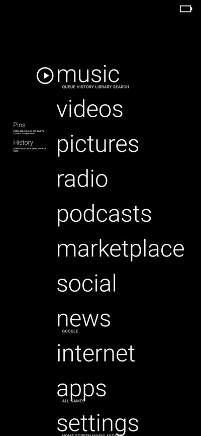
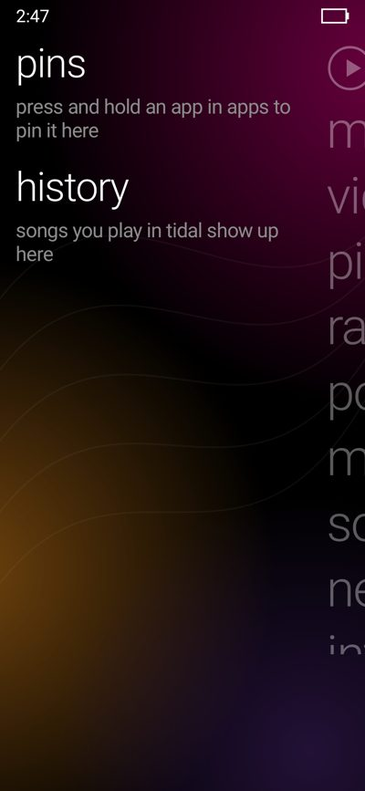
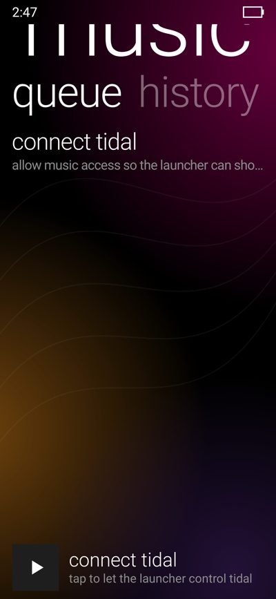
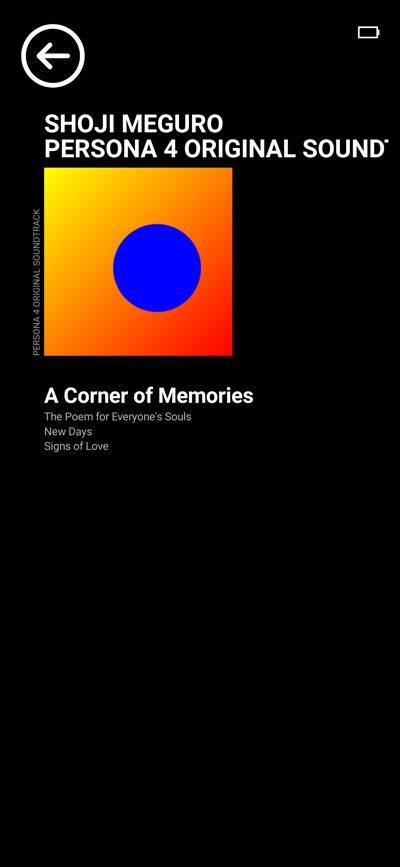
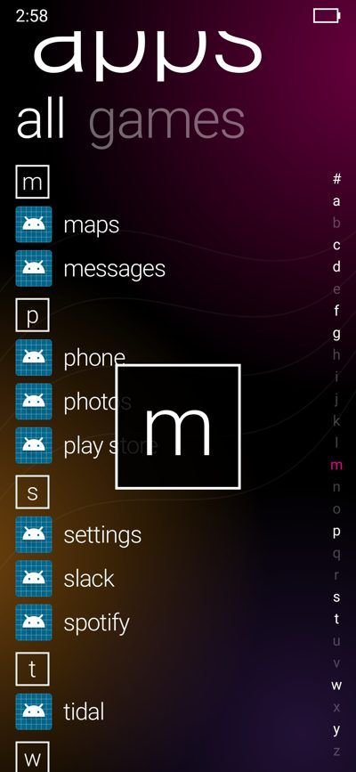
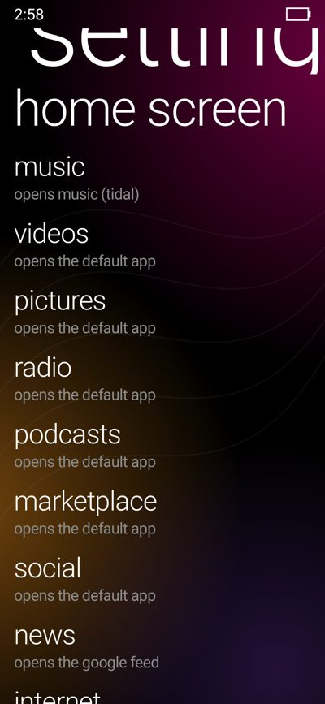

# Zune HD Launcher

An Android home screen that recreates the Zune HD's interface, with **Tidal** playback built in
so music feels like part of the device the way it did on the Zune.

(Rendered headlessly with a sample track; the layout and motion follow footage of a real Zune HD.)

## What's recreated

| Zune HD | Here |
|---|---|
| Full screen with Android's status bar hidden (swipe down from the top to peek); black background (settings > background: black, album art or zune glow); menu words with small uppercase captions ("ALBUMS ARTISTS PLAYLISTS SONGS"), the circled play button beside "music" | Same; captions name what each item opens |
| Quickplay (Playing, Pins, History) and the menu: the pane in front fills the screen, the other shrinks to a small column at the side | Swipe to zoom between them, tap the small one, or press home |
| Leaving a screen, it swings away like a door hinged on the right; the next slides in from the left, item by item | Same, everywhere |
| Pressed art gets a bright white outline | Same; text dims while pressed |
| Tapping "music" flies the word up to become the screen's huge, cropped title | Same for every section; tap the title to go back |
| Pivot headers that slide with the content, rows sliding in | Music: queue · history · library · search; apps: all · games |
| Lists broken up by letter tiles | Apps list, compact, with a letter strip on the right to slide through the alphabet |
| Now playing: circled back arrow, ARTIST and ALBUM in bold capitals, art with the album up its spine, times, the song and the next three, circled extras | Same, with Tidal's shuffle/repeat/favourite as the extras; tap the art for previous / play / next |
| Left alone, now playing becomes the art and giant capitals drifting in alternating directions: art left, album right, artist left | Same, after 9 s, filling the whole screen (album, artist, song); tap to come back |
| Now playing on the lock screen | When the screen goes off while music plays, the ambient now playing waits on the lock screen; swipe up to unlock (settings > lock screen) |
| Media button overlay with song, transport and volume | Press a volume key |
| (new) news | The Google Discover feed, slid in over home like on the Pixel Launcher |
| Tilt on press, staggered slide transitions | On every list item and menu word |

The full layout reconstruction, with sizes in Zune pixels, is in [docs/ZUNE_HD_UI.md](docs/ZUNE_HD_UI.md).

## How Tidal is embedded

Tidal has no public control API on Android, but like every player it publishes a **MediaSession**.
With notification access, the launcher reads that session and drives it directly:

- track, artist, album, art, position and the play queue (`MediaController`)
- play/pause, skip, seek and jumping to any queue item
- Tidal's own extra buttons (favourite, shuffle, repeat, …) from the session's custom actions,
  drawn with Tidal's icons
- **search** and **history** start playback with `playFromSearch`, the request Google Assistant uses
- when Tidal isn't running, play is sent to Tidal's media button receiver, so it resumes in the
  background; the app is only opened if that fails
- **library** tries Tidal's `MediaBrowserService` (what Android Auto uses). Apps often only accept
  callers they recognise; if Tidal refuses, the page says so and the other pages still work.

If something else is playing while Tidal is paused, the launcher follows that player instead
(turn off **follow other players** in settings to stick to Tidal). Any other music app can be
chosen under **music app**.

## Google feed (news)

The Pixel Launcher doesn't draw the Discover feed itself: the Google app attaches to the
launcher's window through its "launcher overlay" service and draws the feed over it.
`FeedClient.kt` speaks that service's binder protocol, the same one Launcher3 and Lawnchair use.

The Google app decides which launchers it serves. Launchers outside Google's list have generally
needed a **debuggable build**, so if **news** opens the Google app instead of sliding the feed
in, install the debug APK (`./gradlew :zune:assembleDebug`,
`zune/build/outputs/apk/debug/zune-debug.apk`). This hasn't been tried on a device yet.

## Install and set up

1. `./gradlew :zune:assembleRelease`, then install `zune/build/outputs/apk/release/zune-release.apk`.
2. Open it and tap **play** (or **connect tidal**) to grant notification access.
   Android 13+ blocks this for apps installed from a file ("App was denied access"). The app
   walks you through it: open **App info**, tap ⋮ in the top corner, **Allow restricted
   settings**, then turn on notification access. Installing with `adb install` avoids the block.
3. **settings > default home** to make it your home screen.
   For now playing on the lock screen, **settings > lock screen** asks for "display over other
   apps", which Android requires before an app can open a screen from the background.
4. **settings > home screen** to show, hide, reorder and rename menu items, add any app to the
   menu, choose the app behind items such as **videos**, hide the play button or change the text
   size. **reset to default** brings back the Zune menu. Long-pressing a menu word also chooses
   its app.
   Long-press an app in **apps** to pin it to quickplay.

### Font

The Zune used Zegoe UI, which can't be distributed. The launcher uses Android's light sans-serif
until you add a font you have: copy `light.ttf` and `regular.ttf` into
`Android/data/dev.zunehd/files/fonts/` (or `zune/src/main/assets/fonts/` before building).
Microsoft's open-source Selawik (Segoe UI metric-compatible) is a good choice.

## Status

- Unit tested: session choice, history, time formatting and pivot motion
  (`./gradlew :zune:testDebugUnitTest`). Screens were checked by rendering them with Robolectric.
- Not yet run on a phone with Tidal, so how much Tidal exposes (custom actions, queue, whether
  it accepts library browsing and searches) is unconfirmed.

## Code (`src/main/java/dev/zunehd/`)

- `Player.kt`: the embedded player: picks and follows Tidal's media session, commands, art, history
- `MediaListener.kt`: the notification listener that unlocks media sessions
- `HomeActivity.kt`, `HomePager.kt`: main menu, quickplay and the zoom between them
- `FeedClient.kt`: the Google feed overlay connection
- `MusicActivity.kt`, `LibraryPage.kt`: queue, history, library, search
- `NowPlayingView.kt`: the now playing screen, fully custom drawn
- `NowPlayingActivity.kt`: now playing, and `LockScreenActivity` for the lock screen
- `PivotView.kt`, `Views.kt`, `Ui.kt`: pivot, status strip, quick controls, mini player, backdrop, tilt, motion
- `HomeEditActivity.kt`: home screen customisation and reset
- `Logic.kt`: Android-free logic covered by unit tests
